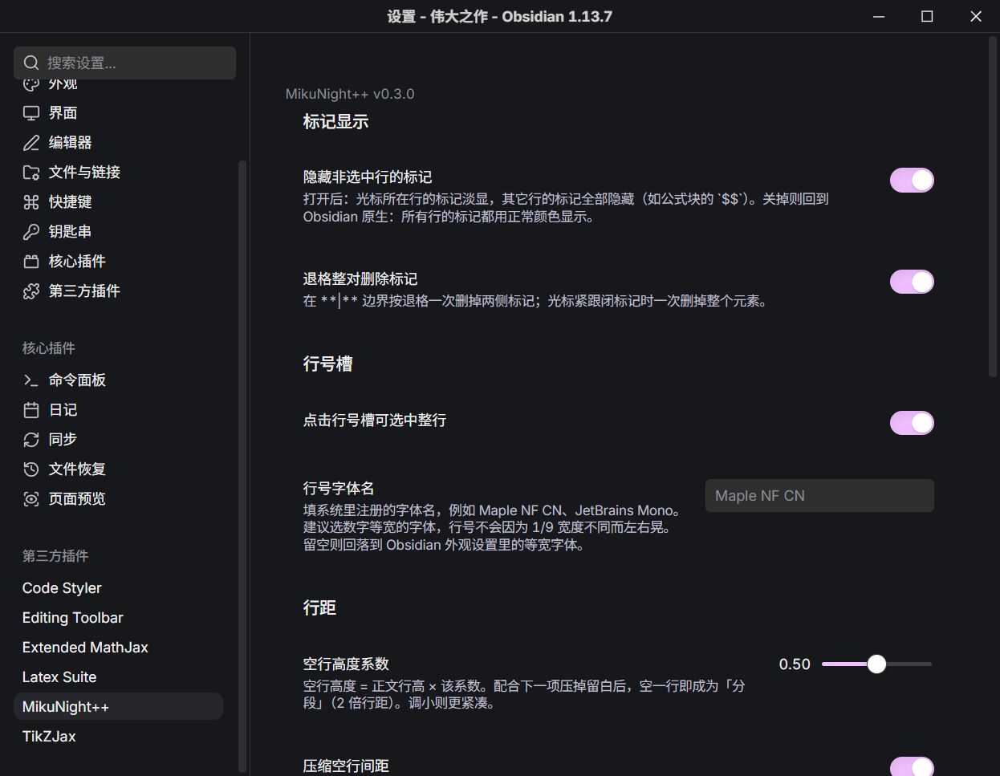

# MikuNight++

The companion enhancement plugin for the MikuNight theme. It provides every setting the theme has, and does the things **plain CSS cannot**: the ones that need to read editor state, the syntax tree or the cursor position, or that need to rewrite the document.

**It does not depend on any other plugin** (Style Settings not needed). **The theme does not depend on this plugin either** — the theme works on its own; you just get no settings panel, so you edit the `:root` variables in `theme.css` instead.

- Companion theme: [MikuNight](https://github.com/AsparagiSanae/obsidian-mikunight) (GPL-3.0)
- This plugin: MIT, see [LICENSE](./LICENSE)
- Requires Obsidian **1.6.0** or later (see `minAppVersion` in `manifest.json`)

## All settings (Settings → MikuNight++)



**Markup display**:

| Item | Description |
| --- | --- |
| Hide markup on unselected lines | On: markup on the cursor line is dimmed (55%) and markup on every other line is hidden, so your eye stays on the line you are editing. Off: back to Obsidian's native behavior — markup on all lines is drawn in the normal color (the two pairs of `$$` around a formula block, for example). |
| Delete paired markup with one backspace | At a boundary like `**\|**`, one backspace removes the markers on both sides; with the cursor right after a closing marker, one backspace removes the whole element |

**Gutter**:

| Item | Description |
| --- | --- |
| Click the gutter to select the whole line | Clicking a line number selects that whole line |
| Line number font name | A font with tabular digits is recommended. **When left empty, the gray placeholder in the text box writes itself the fallback target** (= the name of the monospace font in Appearance settings, e.g. `Maple NF CN`), so you never have to guess which font "fall back to monospace" actually means. The placeholder is display only — **do not** copy it, and above all do not add quotes to it: quotes are the CSS way of writing "a name containing spaces", and the plugin adds them itself when it writes the variable |

**Line spacing / formulas** (written to CSS variables, consumed by the theme's `theme.css`):

| Item | Variable | Description |
| --- | --- | --- |
| Blank line height coefficient | `--mn-empty-line` | Blank line height = body line height × coefficient |
| Compress blank line spacing | `--mn-empty-pad` | Also removes the structural whitespace above and below a blank line |
| Formula scale | `--mn-math-scale` | Formula size = body size × coefficient (slider 0.8 – 2.0, step 0.02, default **0.96** ≈ the native look) |

**Other**: a one-click "Restore default settings".

Changes **take effect immediately**, with no plugin reload: the CSS variables are written as inline styles on `body` (higher priority than the theme's `:root`), and the backspace behavior is reconfigured live through a CodeMirror `Compartment`.

**But editing `main.js` itself does require a plugin reload** (toggle it off and on in the plugin list).

⚠️ To confirm "whether the new `main.js` actually made it into memory", read `buildVersion` on the plugin instance:

```js
app.plugins.plugins['mikunight-plus'].buildVersion   // → '0.3.0'
```

It comes from the `BUILD_VERSION` constant in `main.js`. **Do not read `this.manifest.version`**: Obsidian reads the manifest into its in-memory cache at startup (`app.plugins.manifests`), and **reloading the plugin does not read it again**, so that value lags behind — measured on a real instance, changing the manifest to 0.3.0 and reloading the plugin still returned 0.2.1. Always change the version in both places.

(The top of the settings page used to display this version number; it was removed in 0.3.0 as requested, so the panel carries no version any more.)

**After you uninstall or disable this plugin**, the theme falls back cleanly to the defaults in its own `:root` — every inline variable the plugin wrote is removed in `onunload`.

## Languages

The interface strings come in two sets, **Simplified Chinese / English**. Every user-visible string sits in the `LOCALES` table at the top of `main.js` (the first block, text only, no logic), and the code always goes through `t('key')` instead of string literals — adding a string means adding one row to each of the two tables.

The language is resolved in the order below, taking the first non-empty value:

| Order | Source | Description |
| --- | --- | --- |
| ① | `document.documentElement.lang` | What Obsidian writes to `<html>` at startup from **Settings → About → Language** (`zh` / `zh-TW` / `en`…); the most accurate |
| ② | `localStorage.language` | Where that same value is originally stored; the fallback when ① cannot be read |
| ③ | `navigator.language` | The system language; the last fallback |

**Simplified Chinese only**: `zh` / `zh-CN` / `zh-SG` / `zh-Hans*` → Chinese; everything else → English — **Traditional Chinese included** (`zh-TW` / `zh-HK` / `zh-Hant*` go to English as well, no compromises).

The language is resolved once, when the module loads, so a change to `main.js` again requires a plugin reload; changing Obsidian's own interface language needs an app restart anyway, which is why there is no runtime hot-switch. (The result is stored on the plugin instance as `locale`, so while you are debugging, `app.plugins.plugins['mikunight-plus'].locale` tells you at a glance what was read.)

### The plugin list description follows the language too

Obsidian has **no** mechanism for switching plugin metadata by language (there is no i18n field in `manifest.json` either, and some people in the community have even written plugins specifically to translate other plugins' descriptions). But a plugin can **change itself**: the manifest in memory is an ordinary object, and it is the same object as `plugin.manifest`, so one line in `onload`

```js
this.manifest.description = t('manifest.description');
```

is enough to make the **Settings → Community plugins** list show the current language.

Two gotchas from measuring this on a real instance (2026-10-12), written down so you don't waste the same attempts:

- Once changed, the list DOM does not update unless it is **redrawn**, and switching settings pages does not rebuild it either (this part of Obsidian has no reactivity);
- but **reloading the plugin does redraw that row**, and it reads the value from this same object — and `onload` happens right before the user opens settings, so the production path holds. Verified in both directions.

The copy in `manifest.json` is written in **English**: the community directory is visible to everyone, and while the plugin is not enabled (or in safe mode) what the user sees is the copy on disk, with no chance of being overwritten. Chinese is layered on at runtime by the line above.

The scripts used to verify the localization (one offline static check, two live CDP comparisons and a screenshot tool) are **not shipped with this repository** — they depend on the author's own vault layout and on a CDP debugging port, so they would not run anywhere else. The comments next to the `LOCALES` table at the top of `main.js` say what each of them checks.

## What the plugin implements (and why CSS alone cannot do it)

| Feature | Why CSS cannot do it |
| --- | --- |
| Hide markup on unselected lines | It needs to know which line the cursor is on, and to write decorations segment by segment onto the markup nodes of the syntax tree (natively, every line is treated the same) |
| Delete paired markup as a pair | It needs to intercept the key and rewrite the document |
| Insert horizontal rule command | It is a parsing-level matter (`text` immediately followed by `---` parses as a setext h2) |
| Click the gutter to select the whole line | It needs to take over mousedown and dispatch a selection |

## Design constraints

**Every size is in em / relative units, never hardcoded pixels.** The result has to be identical at any font size and any zoom level; "aligned at 16px, falling apart at 20px" is not allowed.

Measured on a real instance (editor font size set to 14 / 20 / 28px, values taken after normalizing to em):

| Quantity | 14px | 20px | 28px |
| --- | --- | --- | --- |
| List step per level | 1.5em | 1.5em | 1.5em |
| bullet → text | 1.6em | 1.6em | 1.6em |
| Formula / body | 0.960 | 0.960 | 0.960 |
| Image centering offset | 0px | 0px | 0px |

The formula row equals the default of `--mn-math-scale` — a pure ratio, and therefore independent of font size (measured on a real instance: at a 15px base the formula renders at 14.4px, a ratio of 0.96; setting the variable to 1.2 gives 18px).

## Installation

**From the community directory** (once listed): Settings → Community plugins → Browse → search for `MikuNight++` → Install, then enable it.

**Manually**: copy `main.js`, `manifest.json` and `styles.css` into `<your vault>/.obsidian/plugins/mikunight-plus/`, then enable it under **Settings → Community plugins → Installed plugins**.

Once enabled: Settings → **MikuNight++** — 3 behavior toggles, 4 display settings, 1 color setting, plus restore-defaults.

No build step: `main.js` is plain CommonJS, so after an edit you toggle the plugin off and on in the plugin list to reload it. Interface strings follow Obsidian's interface language automatically (Simplified Chinese / English), with no extra configuration.

## Known limits

- **The empty-element shape is a heuristic.** `****` is ambiguous in markdown to begin with: Obsidian parses the four asterisks as "1 opening + 3 closing", and pair matching is useless against it. The plugin instead recognizes the rule "4 consecutive delimiters of the same kind, cursor in the middle gap". It therefore only works in the typical case of Ctrl+B hitting an empty line.
- **A `---` turning into a heading cannot be fixed.** That is CommonMark setext semantics, short of replacing the markdown parser. Use the "Insert horizontal rule" command to write `<hr>`, or leave a blank line between the paragraph and the `---`.
- **Markup hiding is all-or-nothing, not a per-line fade.** The toggle has only two positions: either only the cursor line's markup shows (dimmed 55%), or every line shows normally. There is no in-between state where "some lines are dim and some are normal".
- **With multiple cursors, what counts is which lines are selected.** Under a multi-selection or a whole-line selection (clicking the gutter, for example), that line's markup is dimmed.
- **The visual result depends on the theme's CSS.** This plugin's four display settings only write values into CSS variables; the actual styling is defined by the companion theme's `theme.css`. With any other theme those settings do nothing.

## Credits and license

Two of this plugin's editing behaviors are ported from the habits of [SiYuan](https://github.com/siyuan-note/siyuan):

- **Two kinds of line break**: in SiYuan `Shift+Enter` is a soft break and `Enter` is a hard break, with a clearly different line spacing between them. This plugin brings that to Obsidian — pressing `Enter` and typing is a soft break (body line spacing), while pressing `Enter` twice and typing is a hard break (one blank line = 2× line spacing = a paragraph break), implemented by the theme's `--mn-empty-line`.
- **Click blank space to select the whole line**: SiYuan has no gutter, but clicking "the blank strip between the sidebar and the editor" selects the whole line there. Obsidian has a gutter, so the same interaction is hung on the line number here.

On colors, this plugin only writes values into CSS variables (six bare HSL numbers) and takes no part in any derived computation. The default values of this palette follow the Midnight color scheme of the SiYuan theme [Neo](https://github.com/QYLexpired/Neo) by QYL, and the formula source colors come from [Catppuccin](https://github.com/catppuccin/catppuccin) (MIT).

The plugin code is an independent implementation; it contains no code from the projects above and is not affiliated with them. The companion theme [MikuNight](https://github.com/AsparagiSanae/obsidian-mikunight) is built on Neo and released under GPL-3.0; its license and this plugin's are independent of each other.

**License**: MIT, see [LICENSE](./LICENSE).

## Files

- `manifest.json` — plugin metadata
- `main.js` — all the logic (no build step). The file has two blocks: **the first is the `LOCALES` string tables plus `t()`**, the second is the implementation
- `styles.css` — styles for the decoration classes the plugin writes into the DOM (markup hidden / dimmed), all in em units
- `versions.json` — version → required minimum app version; Obsidian's updater uses it to decide whether an update can be installed
